<a href="https://github.com/anjani24">
  
</a>

  
  
  <!-- Add LinkedIn: replace YOUR-HANDLE and remove these comment markers
  
  -->
  

 



  

<a href="https://github.com/anjani24/Multi-Gesture-Recognition-for-Stroke-Rehabilitation-Using-sEMG-Signals">
  
</a>

  


  
  <a href="https://github.com/anjani24/youtube-rag"></a>

  <a href="https://github.com/anjani24/speech-Aware-Voting-Platform-for-Dysarthric-Users"></a>
  <a href="https://github.com/anjani24/Offer-Personalization"></a>

  <a href="https://swap-sync-theta.vercel.app/"></a>
  <a href="https://github.com/anjani24/Fake-news-Detector"></a>

<b>&nbsp;More projects ↓</b>

 

| Project | What it does |
|---|---|
| [SwapSync source](https://github.com/anjani24/SwapSync) | Next.js + Supabase code behind the live app |
| [Learning PDF using GAN](https://github.com/anjani24/Learning-PDF-using-GAN) | Learns probability distributions with a GAN |
| [TOPSIS Package](https://github.com/anjani24/Topsis-102303480) · [Live ↗](https://topsis-102303480.vercel.app) | Multi-criteria decision-making tool |
| [Mashup](https://github.com/anjani24/Mashup) · [Live ↗](https://mashup-five.vercel.app) | Audio mashup generator web app |
| [TOPSIS on Summarization Models](https://github.com/anjani24/Topsis-on-pretrained-model-for-Text-Summerization) | Ranks pretrained text summarizers |
| [Deep Learning](https://github.com/anjani24/DeepLearning) | Deep learning experiments |

 



  



  


  
  

<!-- Contribution snake: appears after the "Generate snake" workflow runs once (Actions tab → Generate snake → Run workflow) -->

  <picture>
    <source media="(prefers-color-scheme: dark)" srcset="https://raw.githubusercontent.com/anjani24/anjani24/output/github-snake-dark.svg"/>
    <source media="(prefers-color-scheme: light)" srcset="https://raw.githubusercontent.com/anjani24/anjani24/output/github-snake.svg"/>
    
  </picture>

 


<a href="mailto:aagarwal2_be23@thapar.edu">
  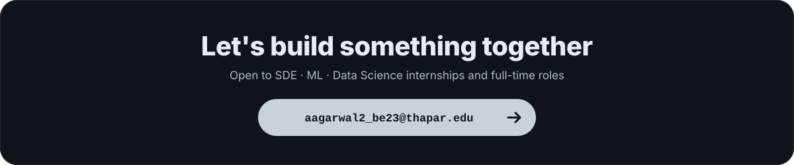
</a>

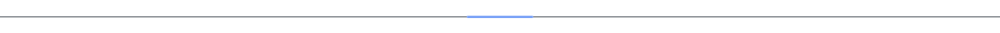
