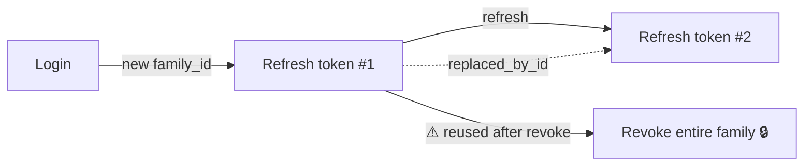

<!-- ========================= HEADER ========================= -->
<p align="center">
  
</p>

<p align="center">
  <a href="https://github.com/anjani24">
    
  </a>
</p>

<p align="center">
  
  
  
</p>

<p align="center">
  <a href="mailto:aagarwal2_be23@thapar.edu"></a>
  <a href="https://github.com/anjani24"></a>
  <!-- Add LinkedIn here:
  <a href="https://www.linkedin.com/in/YOUR-HANDLE"></a>
  -->
</p>

---

## 🧑‍💻 About Me


```python
class Anjani:
    def __init__(self):
        self.education  = "B.E. Computer Engineering @ Thapar Institute (CGPA 8.79)"
        self.focus      = ["Machine Learning", "GenAI & RAG", "Deep Learning", "Full-Stack"]
        self.research   = "Spiking Neural Networks for sEMG gesture recognition @ MNIT Jaipur"
        self.patent     = "Speech-aware voting for dysarthric users (Indian Patent Office)"
        self.looking_for = ["SDE / ML / Data Science Internships", "Full-Time Roles"]

    def fun_fact(self):
        return "I turn YouTube videos into searchable knowledge bases 🎥➡️📚"
```

- 🔭 Currently building **AI-powered products** with LLMs, hybrid retrieval and modern web stacks
- 🌱 Currently building an **AI Task Manager backend** with FastAPI, PostgreSQL, JWT auth and refresh-token rotation
- 🏆 **Runner-up**, HackOWASP (100+ teams) · **Top 30**, Amex Campus Challenge 2025
- 📜 **Patent published** at the Indian Patent Office
- 💬 Ask me about **RAG, LightGBM, SNNs, or Next.js + Supabase**

<br clear="right"/>

---

## 🛠️ Tech Stack

<details open>
<summary><b>💻 Languages</b></summary>
<br/>
<p align="center">
  <a href="https://skillicons.dev"></a>
  <br/>
  
</p>
</details>

<details open>
<summary><b>🤖 Machine Learning, Deep Learning & GenAI</b></summary>
<br/>
<p align="center">
  
  <br/><br/>
  
  
  
  
  
  
  
  
  
  
  
</p>
</details>

<details open>
<summary><b>⚡ Backend & APIs <i>(AI Task Manager stack)</i></b></summary>
<br/>
<p align="center">
  
  <br/><br/>
  
  
  
  
  
  
  
  
</p>
</details>

<details open>
<summary><b>☁️ DevOps, Databases & Tools</b></summary>
<br/>
<p align="center">
  
  <br/><br/>
  
  
  
  
</p>
</details>

<details>
<summary><b>📚 CS Fundamentals</b></summary>
<br/>
<p align="center">
  
  
  
  
  
</p>
</details>

---

## 💼 Experience

<details open>
<summary><b>🔬 Research Intern — Multi-Gesture Recognition using sEMG</b> · MNIT Jaipur · <i>May 2025 – Jul 2025</i></summary>
<br/>

- Built a **multi-gesture recognition system for stroke rehabilitation** from multi-channel sEMG signals using FFT-based spectral analysis and statistical features
- Designed **Leaky Integrate-and-Fire Spiking Neural Networks** trained with surrogate-gradient backprop in **snnTorch** → **85%** accuracy
- Engineered a **hybrid Feature-SNN architecture** → peak **95.25%** test accuracy
- Automated evaluation with confusion matrices and class-wise robustness analysis

🔗 [View project](https://github.com/anjani24/Multi-Gesture-Recognition-for-Stroke-Rehabilitation-Using-sEMG-Signals)
</details>

---

## 🚀 Featured Projects

<p align="center">
  <a href="https://github.com/anjani24/youtube-rag"></a>
  <a href="https://github.com/anjani24/speech-Aware-Voting-Platform-for-Dysarthric-Users"></a>
  <a href="https://github.com/anjani24/Offer-Personalization"></a>
  <a href="https://github.com/anjani24/SwapSync"></a>
</p>

<details open>
<summary><b>🧠 AI Task Manager Backend</b> — secure task API, AI-agent ready · </summary>
<br/>

**Stack:** Python · FastAPI · PostgreSQL · SQLAlchemy · Alembic · JWT · Argon2 · Pytest

- **REST API** with full task CRUD, **pagination and sorting**, built for future AI agent integration
- Relational data model with **SQLAlchemy** (primary/foreign keys, relationships) and **Alembic** migrations that safely handle existing data
- **JWT access + refresh tokens** with **Argon2** password hashing, plus user-level authorization so each user only sees their own tasks
- **Refresh-token rotation with reuse detection:**
  - every login starts a token `family_id`
  - each refresh revokes the old token and links it to its replacement via `replaced_by_id`
  - replaying a revoked token **revokes every active token in that family**, which shuts down stolen sessions
- Covered by automated **Pytest** suites, including the token rotation and reuse-detection tests


</details>

<details>
<summary><b>🎥 YouTube Knowledge Intelligence</b> — RAG over YouTube videos</summary>
<br/>

**Stack:** Python · ChromaDB · OpenAI · BM25 · sentence-transformers

- End-to-end **RAG system** with 6 capabilities: Q&A, summarization, topic search, multi-video comparison, quiz generation and **timestamp-backed citations**
- **Hybrid retrieval** (semantic + BM25 fused via RRF) with cross-encoder reranking — beats semantic-only and keyword-only search
- Persistent ChromaDB knowledge base and a RAG evaluation framework with swappable LLM / embedding / vector-store components
</details>

<details>
<summary><b>🗳️ Speech-Aware Voting Platform</b> — 📜 Patent Published</summary>
<br/>

**Stack:** TypeScript · React · PostgreSQL · Docker · AWS · GitHub Actions · Wav2Vec2

- Speech-to-vote pipeline for **dysarthric speech** by fine-tuning Wav2Vec2 → **87%** recognition accuracy
- Productionized with Docker + AWS, **CI/CD via GitHub Actions**, health checks, structured logging and monitoring
- Accessible React UI with real-time transcription and encrypted, auditable vote records
</details>

<details>
<summary><b>💳 Offer Personalization Engine</b> — credit-card offer recommendations</summary>
<br/>

**Stack:** Python · Pandas · LightGBM · scikit-learn · SHAP

- Modeled **10,000+ customers** across 70+ demographic and offer attributes
- Gradient-boosted model with **ROC-AUC 0.89** and a **Top-3 ranking** recommender per customer
- SHAP-based explainability for every recommendation
</details>

<details>
<summary><b>🏠 SwapSync</b> — hostel room swapping platform · <a href="https://swap-sync-theta.vercel.app/">Live ↗</a></summary>
<br/>

**Stack:** Next.js · TypeScript · Supabase

- Room discovery, reverse matching and **three-way circular swaps**
</details>

<details>
<summary><b>📰 More projects</b></summary>
<br/>

| Project | What it does | Stack |
|---|---|---|
| [Fake News Detector](https://github.com/anjani24/Fake-news-Detector) | NLP classifier, **90.31%** test accuracy | TF-IDF · LR · SVM · RF |
| [Learning PDF using GAN](https://github.com/anjani24/Learning-PDF-using-GAN) | Learns probability distributions with GANs | PyTorch |
| [TOPSIS Package](https://github.com/anjani24/Topsis-102303480) · [Live ↗](https://topsis-102303480.vercel.app) | Multi-criteria decision making tool | Python |
| [Mashup](https://github.com/anjani24/Mashup) · [Live ↗](https://mashup-five.vercel.app) | Audio mashup generator web app | Python |
| [TOPSIS on Summarization Models](https://github.com/anjani24/Topsis-on-pretrained-model-for-Text-Summerization) | Ranks pretrained summarizers | Transformers |
| [Deep Learning](https://github.com/anjani24/DeepLearning) | Deep learning experiments | PyTorch |

</details>

---

## 🏆 Achievements

<p align="center">
  
  
  
</p>

---

## 📊 GitHub Stats

<p align="center">
  
  
</p>

<p align="center">
  
</p>

<p align="center">
  
</p>

<!-- Contribution snake: appears after the snake workflow runs once (Actions tab → "Generate snake" → Run workflow) -->
<p align="center">
  <picture>
    <source media="(prefers-color-scheme: dark)" srcset="https://raw.githubusercontent.com/anjani24/anjani24/output/github-snake-dark.svg"/>
    <source media="(prefers-color-scheme: light)" srcset="https://raw.githubusercontent.com/anjani24/anjani24/output/github-snake.svg"/>
    
  </picture>
</p>

---

## 🤝 Let's Work Together

<p align="center">
  <b>I'm actively looking for Internship & Full-Time opportunities in<br/>Machine Learning · GenAI · Data Science · Software Engineering</b>
  <br/><br/>
  <a href="mailto:aagarwal2_be23@thapar.edu">
    
  </a>
</p>

<p align="center">
  
</p>
